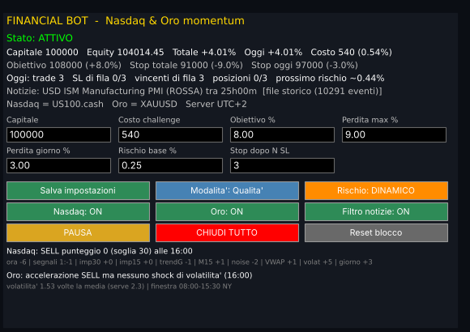

# FINANCIAL BOT: EA per MetaTrader 5, Nasdaq e oro (momentum intraday)

Un solo Expert Advisor, da mettere su **un solo grafico**. Fa trading da solo sul **Nasdaq 100** (il motore principale) e sull'**oro** (solo nei rari "shock" di volatilità). Rispetta sempre le regole che imposti: capitale, obiettivo, perdita massima, perdita giornaliera, rischio per trade e massimo 3 posizioni aperte.

Non usa machine learning: ogni decisione è una regola fissa e verificabile.

---

## 1. Installazione (circa 10 minuti, una volta sola)

1. **Copia l'EA.** In MetaTrader 5 apri `File > Apri cartella dati` e poi `MQL5 > Experts`. Copia lì `FINANCIAL_BOT.mq5`.
2. **Compila.** Premi F4 per aprire MetaEditor, apri `FINANCIAL_BOT.mq5` e premi **F7 (Compila)**. In basso deve comparire `0 errors`.
   - Se compaiono errori, mandami il testo esatto. Ho verificato il codice con un mio compilatore di controllo, ma da qui non ho potuto eseguire MetaEditor (vedi il paragrafo 9).
3. **Abilita il trading automatico.** In `Strumenti > Opzioni > Expert Advisors`:
   - spunta **Consenti il trading algoritmico**;
   - facoltativo ma consigliato: spunta **Consenti WebRequest per i seguenti URL** e aggiungi `https://nfs.faireconomy.media` (calendario notizie di riserva).
4. **Controlla lo storico dei grafici.** In `Strumenti > Opzioni > Grafici`, **Barre max nel grafico** deve essere almeno 10.000 (va bene anche "Illimitato").
5. **Avvia l'EA.** Apri **un** grafico qualsiasi (consigliato: US100 o NAS100, M5) e trascinaci sopra `FINANCIAL_BOT`. Nella scheda "Comune" spunta "Consenti trading algoritmico", poi premi OK.
6. **Accendi il pulsante "Algo Trading"** nella barra in alto: deve diventare verde.
7. **Controlla il pannello** in alto a sinistra:
   - **Stato: ATTIVO**;
   - i nomi dei simboli trovati (es. `US100.cash` e `XAUUSD`);
   - il **Capitale** corretto;
   - una riga **Notizie** con la prossima notizia.
8. **Tieni MT5 acceso 24 ore su 24 dal lunedì al venerdì.** È meglio una VPS (un PC in cloud, 10-20 €/mese), vicina al server del broker.

Non serve altro: simboli, orario del server, capitale e notizie vengono riconosciuti in automatico.

> **Una sola copia dell'EA per conto.** Se lo trascini su un secondo grafico dello stesso conto, il secondo si rifiuta di partire. Così si evitano trade doppi.
> **Non rimuovere l'EA con posizioni aperte.** Lo stop loss resta sul server, ma l'uscita a tempo e il trailing li gestisce l'EA.

---

## 2. Il pannello

*(immagine generata dal codice dell'EA nel simulatore: in MT5 i caratteri sono leggermente diversi)*

| Riga / pulsante | Cosa mostra o cosa fa |
|---|---|
| **Stato** | ATTIVO, IN PAUSA, FERMO PER OGGI (con il motivo) oppure FERMO definitivo (obiettivo raggiunto o perdita massima) |
| **Capitale / Equity** | Capitale di riferimento, equity, risultato totale e di oggi in %, costo della challenge |
| **Limiti** | Livelli in denaro: obiettivo, stop totale, stop di oggi |
| **Oggi** | Trade fatti, stop di fila (x/3), vincenti di fila, posizioni aperte (x/3), rischio del prossimo trade |
| **Notizie** | Prossima notizia rossa o gialla e quanto manca; fonte (calendario MT5 / ForexFactory) |
| **Campi modificabili** | Capitale, Costo challenge, Obiettivo %, Perdita max %, Perdita giorno %, Rischio base %, Stop dopo N SL. Scrivi il valore e premi **Salva impostazioni** |
| **Modalità** | Passa tra Qualità, Bilanciata e Alta frequenza (vedi il paragrafo 4) |
| **Rischio** | DINAMICO (consigliato) o FISSO |
| **Nasdaq / Oro / Filtro notizie** | Accendono o spengono ciascuna parte |
| **PAUSA / RIPRENDI** | Sospende i nuovi ingressi. Le posizioni aperte continuano a essere gestite |
| **CHIUDI TUTTO** | Chiude subito le posizioni dell'EA |
| **Reset blocco** | Toglie il fermo definitivo (obiettivo o perdita massima). Usalo solo quando ricominci su un nuovo conto o una nuova fase |
| **Ultime righe** | L'ultimo segnale per Nasdaq e oro, con il punteggio e il dettaglio dei punti |

Ogni evento (segnali, ingressi, uscite, blocchi, riepilogo di fine giornata) viene scritto in `MQL5/Files/FINANCIAL_BOT_log.csv`. Si apre con Excel.

---

## 3. Le regole che rispetta sempre

| Regola | Valore predefinito | Come funziona |
|---|---|---|
| Rischio per trade | 0,25% del capitale | Con il rischio dinamico varia tra 0,12% e 0,75% (vedi sotto). Non c'è interesse composto: il rischio si calcola sul capitale iniziale |
| Posizioni aperte | massimo **3** sul conto | Conta anche le posizioni manuali o di altri EA: se ne vede 3, non apre |
| Perdita giornaliera | **3%** (la prop di solito ne concede 5%) | Non apre un trade se lo stop di tutte le posizioni insieme supererebbe il limite. Se l'equity tocca il −3%, chiude tutto e si ferma fino al giorno dopo |
| Perdita massima | **9%** (la prop di solito ne concede 10%) | Avvicinandosi al limite riduce il rischio. Al −9% chiude tutto e si ferma definitivamente |
| Stop di fila | **3** | Dopo 3 trade in perdita consecutivi si ferma per il resto della giornata |
| Protezione del profitto | da +2% | Se la giornata ha superato +2% e poi restituisce metà del massimo, smette di aprire per oggi. Le giornate buone invece corrono: nessun limite al guadagno |
| Obiettivo | **8%** (fase 1; metti 5 per la fase 2, 0 sul conto finanziato) | Raggiunto l'obiettivo chiude tutto e si ferma |
| Giorni minimi | **4** | Dopo l'obiettivo, se la prop richiede un minimo di giorni di trading, apre **un solo micro-trade al giorno** (lotto minimo, 2 minuti, rischio di circa 1 $) finché li raggiunge |
| Notizie | rosse e gialle USD, **5 minuti prima e 5 dopo** | Nessun nuovo ingresso in quella finestra. Dopo può entrare normalmente |
| Orari | — | Nessun ingresso tra le 16:00 e le 18:30 di New York (chiusura e riapertura giornaliera) né il venerdì dopo le 15:30 di New York. Tutte le posizioni chiudono entro le 16:50 di New York: niente posizioni nella notte di chiusura né nel weekend |
| Durata | massimo **2 ore** | Ogni trade chiude al più tardi dopo 120 minuti |
| Inattività | dopo **90 minuti** senza ingressi | La soglia del punteggio scende di 10 punti: dopo una lunga attesa entra al primo segnale accettabile |
| Spread | — | Salta il trade se lo spread è anomalo (oltre un quarto dell'ATR a 5 minuti) |

**Rischio dinamico.** Ogni trade parte dal rischio base e viene adattato in tre modi:
- **punteggio:** sotto 20 → ×0,5; tra 20 e 40 → ×1; da 40 in su → ×1,5;
- **vincite di fila:** +25% per ogni trade vincente consecutivo di oggi, fino a ×2;
- **perdita sul totale:** se il conto è in perdita, il rischio scende in proporzione, fino a ×0,4;
- **oro:** il rischio è sempre dimezzato.

---

## 4. Come decide (spiegato semplice)

A ogni chiusura di candela da 5 minuti l'EA cerca un'**accelerazione** del Nasdaq. Ci sono 5 segnali:

1. **Impulso 15 minuti:** il prezzo si è mosso di almeno 1,5 volte la volatilità normale (ATR) in 3 candele.
2. **Impulso 30 minuti:** almeno 2,5 ATR in 6 candele.
3. **VWAP:** il prezzo è lontano dal prezzo medio della giornata, a favore del trend a 1 ora.
4. **Pullback nella giornata di trend:** dopo un ritorno sulla media a 20 periodi il prezzo riparte nella direzione del trend.
5. **Uscita dalla "noise area":** il prezzo esce dalla fascia di movimento normale per quell'orario (metodo Zarattini-Aziz-Barbon, usato sui fondi momentum).

Se almeno un segnale scatta e nessuno indica la direzione opposta, l'EA calcola un **punteggio di qualità**. I punti dipendono da:
- la fascia oraria (le ore di New York valgono di più);
- quanti segnali concordano;
- la forza dell'impulso;
- il trend giornaliero e a 15 minuti;
- la noise area;
- la distanza dal VWAP;
- l'aumento di volatilità;
- il giorno della settimana.

**Entra solo se il punteggio supera la soglia** della modalità:

| Modalità | Soglia | Trade al giorno | Per chi |
|---|---|---|---|
| **Qualità (predefinita)** | 30 | 3,4 | Le challenge: passa più spesso e ha cali più piccoli |
| Bilanciata | 20 | 5,1 | Più trade e in media payout un po' più alti, ma passa meno challenge (80% contro 87%) e ha cali più profondi |
| Alta frequenza | 10 | 6,1 | Solo se vuoi molta azione: vantaggio per trade basso, 2 anni negativi su 16 |

Si cambia con il pulsante **Modalità** del pannello o con l'input `InpMode`.

**Uscita.** Lo stop loss è a 1,5 ATR e non c'è target: il trade corre. Dopo un guadagno di 4 ATR parte un trailing stop a 3 ATR, e in ogni caso l'uscita avviene dopo 2 ore.

Il risultato tipico è questo:
- un terzo dei trade vince, in media **+2,2 volte il rischio**;
- due terzi perdono, in media **−1 volta il rischio**;
- le perdite sono piccole e veloci (durata mediana 16 minuti), mentre i vincenti di solito restano aperti fino alla chiusura delle 2 ore.

**Oro.** Entra solo durante uno shock di volatilità, quando l'ATR a 5 minuti è oltre 2,3 volte la sua media di un giorno. Lo fa nella sessione di New York (08:00-15:30), circa una volta ogni 5 giorni di borsa e con metà rischio. Sull'oro non ho trovato altro che reggesse ai test.

---

## 5. Cosa aspettarsi (numeri veri del codice dell'EA)

Ho eseguito **proprio questo codice** su 16 anni di dati al minuto (Nasdaq 2011-2026, oro 2016-2026). Le condizioni del test:
- costi realistici: spread di circa 1,5 punti sul Nasdaq e 0,40 $ sull'oro;
- un ingresso solo all'apertura della candela successiva;
- stop eseguiti sul massimo e minimo di ogni minuto.

### Trading continuo (rischio base 0,25%, senza obiettivo né fermo definitivo)

| | **Qualità** | Bilanciata | Alta frequenza |
|---|---|---|---|
| Trade al giorno | 3,4 | 5,1 | 6,1 |
| Trade vincenti | 35% | 34% | 33% |
| Risultato medio per trade | +0,13 R | +0,09 R | +0,05 R |
| Risultato medio al giorno | +0,15% | +0,15% | +0,09% |
| Giorni positivi | 33% | 30% | 26% |
| Giorno migliore / peggiore | +12,7% / −2,6% | +21,2% / −2,6% | +17,9% / −2,5% |
| Massimo calo (somma dei giorni) | **21%** | 38% | 32% |
| Mese peggiore | −8,6% | −11,3% | −9,4% |
| Mesi positivi | 120 su 190 | 122 su 190 | 107 su 190 |
| Anni negativi | **0 su 16** | 1 su 16 | 2 su 16 |
| 2011, 2012, 2013 (anni mai visti) | **+24%, +16%, +10%** | +51%, −19%, +3% | +20%, −14%, −5% |
| Media per anno 2014-2026 | +42% | +45% | +28% |
| Durata mediana di un trade | 35 min | 36 min | 34 min |

*R = rischio del trade: +0,13 R vuol dire che in media ogni trade guadagna il 13% di quanto rischia, costi inclusi.*

**Come leggerla, onestamente:**
- **Due giorni su tre chiudono in leggera perdita.** Il guadagno arriva da pochi giorni molto forti, quando il Nasdaq "accelera" e il trailing lascia correre. Serve pazienza: non spegnerlo dopo qualche giorno negativo.
- **I trade perdenti durano poco** (mediana 16 minuti, poi scatta lo stop), **i vincenti di solito restano aperti tutte le 2 ore.**
- **Gli anni 2011-2013 non li ho mai usati per costruire il sistema:** sono il test più severo. Qualità li ha chiusi tutti in positivo, Bilanciata ha avuto un 2012 a −19%. Possono tornare periodi deboli.
- **Il 2014-2026 è il periodo su cui ho stimato il punteggio, quindi è ottimistico.** Per questo ho fatto anche la prova "come se l'avessi costruito nel 2021" (più sotto).

### Challenge simulate sulla storia (modalità Qualità)

Ho fatto partire una challenge da 100.000 $ **all'inizio di ogni mese** dal 2011 al 2026, in tutto 182. Le condizioni:
- fase 1: obiettivo 8%; fase 2: obiettivo 5%;
- regole prop controllate minuto per minuto: perdita giornaliera 5%, perdita totale 10%;
- poi 6 mesi di conto finanziato con payout mensile all'80%.

| | Tutto 2011-2026 | 2011-2013 (mai visti) | 2014-2021 | 2022-2026 |
|---|---|---|---|---|
| Fase 1 superata | 90% | 77% | 94% | 92% |
| Fase 1 persa | 7% | 11% | 6% | 4% |
| Fase 2 superata (dopo la fase 1) | 96% | 85% | 99% | 98% |
| **Entrambe le fasi superate** | **87%** | **66%** | **93%** | **90%** |
| Giorni di trading per la fase 1 (mediana) | 29 | 45 | 24 | 41 |
| Giorni di trading per la fase 2 (mediana) | 12 | 9 | 16 | 11 |
| Payout nei primi 6 mesi da finanziato (media) | 9.776 $ | 5.176 $ | 13.279 $ | 5.297 $ |
| Finanziati con almeno un payout in 6 mesi | 80% | 52% | 92% | 70% |
| Finanziati persi entro 6 mesi | 11% | 0% | 8% | 24% |
| **Guadagno medio per challenge (payout − 500 $)** | **7.987 $** | **2.901 $** | **11.811 $** | **4.278 $** |

- **Nessuna violazione delle regole prop** in tutte le circa 650 challenge simulate (le 182 qui sopra più le varianti dei paragrafi successivi). In Qualità la perdita giornaliera peggiore è stata del **2,45%** (la prop ne concede 5%) e il calo totale peggiore del **9,0%** (la prop ne concede 10%).
- "Persa" comprende i conti rimasti fermi vicino al −9%. Lì l'EA riduce il rischio finché non può più aprire senza rischiare di sforare: nessuna violazione, ma la challenge di fatto è finita.
- Con **Bilanciata** le stesse 182 challenge danno: entrambe le fasi superate nell'**80%** dei casi (54% nel 2011-2013), payout medio 11.772 $, guadagno medio 8.944 $ per challenge.

### La prova più severa: "come se l'avessi costruito nel 2021"

Ho ricostruito il punteggio usando **solo i dati fino al 2021** e l'ho fatto girare sulle challenge 2022-2026, cioè su dati per lui completamente nuovi. È la stima più vicina a quello che succederà da domani:

| Challenge 2022-2026, punteggio costruito solo fino al 2021 | **Qualità** | Bilanciata |
|---|---|---|
| Entrambe le fasi superate | **80%** | 76% |
| Fase 1 persa | **6%** | 14% |
| Finanziati con almeno un payout in 6 mesi | **78%** | 59% |
| Finanziati persi entro 6 mesi | **29%** | 41% |
| Payout medio in 6 mesi | 7.727 $ | 10.549 $ |
| Guadagno medio per challenge | 5.712 $ | 7.567 $ |

### E usare Bilanciata solo sul conto finanziato?

Ho provato anche questo: fasi 1 e 2 in Qualità, poi Bilanciata sul conto finanziato. **Non conviene.**
- Il guadagno medio scende a 6.868 $ per challenge, contro 7.987 $ restando in Qualità.
- I conti finanziati con almeno un payout scendono dall'80% al 76%.

**Qualità o Bilanciata?** Bilanciata, usata dall'inizio alla fine, ha guadagnato in media un po' di più per challenge (8.944 $ contro 7.987 $). Però passa meno challenge e concentra i guadagni su meno conti. Su 10 challenge, quelle che arrivano ad almeno un payout sono:
- su tutta la storia: circa 7 con Qualità, 6,7 con Bilanciata;
- nella prova "costruita nel 2021": 6,2 con Qualità, 4,5 con Bilanciata.

Per un piano come "10 challenge e almeno qualche payout" **Qualità è la scelta più affidabile**, ed è quella predefinita.

### Se compri 10 challenge, una al mese

Sulla storia 2011-2026, comprando 10 challenge in 10 mesi consecutivi (modalità Qualità):
- **in 6 periodi su 10 passano tutte e 10**, e nel 90% dei periodi ne passano almeno 6;
- **nel periodo peggiore (partenze nel 2011) ne passano solo 2-3**;
- il **12% dei periodi** chiude in perdita: i payout dei primi 6 mesi non ripagano i 5.000 $ di costo. È successo partendo nel 2011-2012 e nella primavera 2023.

---

## 6. Perché non 20-23 trade al giorno

Ho cercato a lungo. Ho provato soglie più basse, più segnali e altri strumenti, e su 12 anni di dati il risultato è sempre lo stesso: **più trade vuol dire meno vantaggio per trade**. Spread e commissioni si mangiano il guadagno dei segnali più deboli.

La tabella del paragrafo 5 lo mostra bene. Passando da 3,4 a 6,1 trade al giorno:
- il guadagno per trade scende da +0,13 R a +0,05 R;
- il risultato giornaliero scende da +0,15% a +0,09%;
- gli anni negativi passano da 0 a 2.

Con 20 trade al giorno bisognerebbe prendere segnali che in media perdono. Per una challenge conta il vantaggio per trade, non il numero di trade.

---

## 7. Consigli per le challenge

- **Usa la modalità Qualità per le fasi 1 e 2** (è la predefinita).
- **Resta in Qualità anche sul conto finanziato:** cambiare modalità dopo le fasi non ha migliorato i payout nei test (paragrafo 5).
- **Non fare partire 10 challenge lo stesso giorno con lo stesso EA.** Farebbero esattamente gli stessi trade: passerebbero o fallirebbero tutte insieme. È meglio **scaglionarle**, per esempio 2-3 al mese, così periodi diversi del mercato si compensano.
- **Fase 2:** sul nuovo conto metti `Obiettivo % = 5`, dal pannello o negli input.
- **Conto finanziato:** metti `Obiettivo % = 0`.
- **Lascia** `Perdita max % = 9` e `Perdita giorno % = 3` anche se la prop concede 10% e 5%. Il margine serve per gli slittamenti.
- **Leggi le regole della tua prop**, perché alcune hanno vincoli che l'EA non può conoscere:
  - **EA consentiti?** FTMO e la maggior parte sì.
  - **Notizie:** alcune vietano operazioni a ridosso delle notizie sui conti finanziati. In quel caso metti `InpNewsCloseMin = 3`: l'EA chiude le posizioni 3 minuti prima delle notizie rosse.
  - **Regola di coerenza:** alcune vietano che un solo giorno faccia più del X% del profitto totale. Questo EA ha giornate molto forti (fino a +12% in Qualità), quindi con una regola del genere va valutato.
  - **Capitale:** se il riconoscimento automatico sbaglia, scrivilo a mano nel pannello.
- **Prima di usarlo su una challenge, fallo girare 1-2 settimane su un conto demo del tuo broker.** Controlla nel log che:
  - simboli, orari e notizie siano corretti;
  - lo spread reale sia simile a quello dei test.

---

## 8. Backtest nel Tester di MetaTrader 5 (facoltativo)

1. Copia `Common_Files/FINANCIAL_BOT_news_history.csv` nella cartella comune dei terminali: `C:\Users\<utente>\AppData\Roaming\MetaQuotes\Terminal\Common\Files`. Da MT5 ci arrivi da `File > Apri cartella dati`, risalendo di due livelli fino a `Terminal`, poi `Common > Files`. Il file contiene le notizie 2010-gen 2026; nel tester il calendario MT5 non esiste.
2. Apri il Tester (Ctrl+R):
   - Expert: `FINANCIAL_BOT`;
   - simbolo: US100 (o il nome del Nasdaq del tuo broker);
   - periodo M5;
   - modellazione **"Ogni tick basato su tick reali"** oppure **"1 minuto OHLC"**.
3. Negli input metti `InpTesterUTCOffset = 2` se il server è come FTMO (GMT+2 d'inverno, GMT+3 d'estate). L'EA opera anche l'oro nello stesso test (il tester MT5 supporta più simboli).
4. I risultati dipendono dai dati storici e dagli spread del tuo broker, quindi non saranno identici ai miei.

---

## 9. Come ho verificato il codice

- **Compilazione.** Da questo ambiente non ho potuto avviare MetaEditor: l'esecuzione di programmi Windows esterni è stata bloccata dai permessi della sessione. Ho quindi scritto un mio traduttore MQL5 → C++ con tutte le funzioni MT5 simulate e ho compilato l'EA con g++ in modalità rigorosa: **0 errori, 0 avvisi**. Il traduttore intercetta errori come enum sbagliati, nomi inesistenti, punti e virgola mancanti e tipi di argomento errati. MetaEditor resta l'unico giudice finale: premi F7 e controlla che dica 0 errori.
- **Esecuzione reale.** Lo stesso codice gira in un broker simulato su 16 anni di dati al minuto, con controlli di memoria (AddressSanitizer e UBSan): nessun errore.
- **Fedeltà alla ricerca.** Dal febbraio 2014 i segnali e i punteggi dell'EA coincidono con quelli della ricerca: **423.733 segnali su 423.739, punteggio identico**. Anche l'esito di ogni trade è lo stesso (correlazione 0,97, stesso segno nel 98,6% dei casi). La tabella dei punti nell'EA è identica, numero per numero, a quella della ricerca.
- **Prove delle regole.** Ho verificato una per una:
  - obiettivo raggiunto → fermo definitivo e micro-trade per i giorni minimi;
  - perdita giornaliera e 3 stop di fila → fermo fino al giorno dopo;
  - avvicinamento alla perdita massima → rischio ridotto, nessuno sforamento;
  - notizie: ±5 minuti esatti, calendario MT5 e ForexFactory;
  - fuso orario del server in estate e in inverno;
  - pannello e tutti i pulsanti;
  - seconda copia dell'EA rifiutata.

  Durante queste prove ho trovato e corretto un errore serio: dopo l'obiettivo (o la perdita massima), l'EA ripartiva il giorno dopo.
- **Robustezza.** Ho fatto quattro prove:
  - anni mai visti (2011-2013);
  - punteggio ricostruito solo fino al 2021 e provato sul 2022-2026;
  - confronto tra le tre modalità;
  - 182 challenge storiche per modalità.

Gli strumenti di verifica sono nella cartella `verifica/` per chi vuole ripetere i test.

---

## 10. Problemi comuni

| Messaggio | Soluzione |
|---|---|
| "nessun simbolo Nasdaq/oro trovato" | Scrivi il nome esatto negli input `InpNasdaqSymbol` / `InpGoldSymbol` (come compare in "Simboli" di MT5) |
| "STORICO M5 INSUFFICIENTE" | Aumenta `Barre max nel grafico` (paragrafo 1, passo 4) e apri una volta il grafico M5 del simbolo |
| "Notizie: NON DISPONIBILE" | Il broker non fornisce il calendario: abilita WebRequest per `https://nfs.faireconomy.media` |
| "conto NETTING" | Il conto non è di tipo hedging: l'EA tiene al massimo 1 posizione per simbolo |
| Server con orario strano | Se il broker non usa l'ora legale americana, metti `InpServerDST = 0` (ora fissa) o `2` (ora legale europea) |
| Nessun trade per ore | Normale: entra solo quando c'è un'accelerazione con un buon punteggio. Controlla nel pannello l'ultimo segnale e il suo punteggio |

---

## 11. Avvertenza

Questo è uno strumento costruito con cura e verificato a fondo sui dati storici, ma **i risultati passati non garantiscono quelli futuri**. Il mercato può cambiare, come mostrano gli anni 2011-2013. Usa solo denaro che puoi permetterti di perdere, come il costo delle challenge, e inizia da un conto demo.
