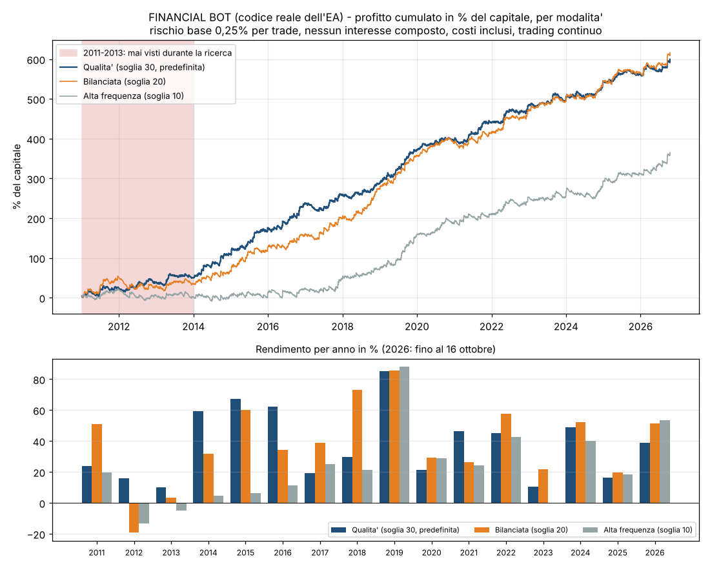

# FINANCIAL BOT

Expert Advisor per **MetaTrader 5** che fa trading da solo sul **Nasdaq 100** e sull'**oro**: momentum intraday, con un punteggio di qualità deterministico (niente machine learning) e regole pensate per le **challenge delle prop firm**.

- **Un solo EA, su un solo grafico.** Riconosce da solo simboli (es. `US100.cash`, `NAS100`, `XAUUSD`), capitale, fuso orario del server e notizie.
- **Entra solo quando il Nasdaq accelera** e il punteggio del segnale supera la soglia. Lo stop è a 1,5 ATR, non c'è target (il trade corre) e l'uscita arriva al massimo dopo 2 ore.
- **Rispetta sempre i limiti:**
  - massimo 3 posizioni sul conto;
  - perdita giornaliera 3%, perdita massima 9%;
  - stop per la giornata dopo 3 stop loss di fila;
  - pausa di ±5 minuti sulle notizie rosse e gialle;
  - obiettivo con fermo automatico;
  - giorni minimi di trading richiesti dalla prop.
- **Pannello di controllo in italiano:** capitale, costo della challenge, obiettivo, limiti, rischio, modalità, pausa e chiusura.

## Come iniziare

Scarica il repository (pulsante **Code > Download ZIP**) e apri la cartella [`FINANCIAL_BOT`](FINANCIAL_BOT). Il manuale completo è in [`FINANCIAL_BOT/LEGGIMI.md`](FINANCIAL_BOT/LEGGIMI.md).

1. Copia `FINANCIAL_BOT.mq5` in `MQL5/Experts`: in MT5 apri `File > Apri cartella dati`.
2. Aprilo in MetaEditor (F4) e premi **F7**: deve comparire `0 errors`.
3. In `Strumenti > Opzioni > Expert Advisors` abilita il trading algoritmico.
4. Trascina `FINANCIAL_BOT` su **un** grafico e accendi **Algo Trading**.
5. Fase 2 della challenge: imposta obiettivo 5%. Conto finanziato: imposta obiettivo 0.

## Risultati (codice reale dell'EA, dati al minuto 2011-2026)

Modalità **Qualità** (predefinita), rischio base 0,25% per trade, costi inclusi:

| | |
|---|---|
| Trade al giorno | 3,4 (vincenti 35%: in media +2,2 volte il rischio contro −1) |
| Anni negativi | 0 su 16, compresi i 2011-2013 mai visti durante la ricerca |
| Massimo calo (trading continuo) | 21% |
| Challenge simulate (182, una al mese, fase 1 all'8% e fase 2 al 5%) | entrambe le fasi superate nell'**87%** dei casi (66% nel 2011-2013) |
| Prova più severa: punteggio costruito solo fino al 2021, challenge 2022-2026 | **80%** |
| Violazioni delle regole prop (5% al giorno, 10% totale) | nessuna su circa 650 simulazioni |

Due giorni su tre chiudono in leggera perdita: il guadagno arriva da pochi giorni forti. Gli anni 2011-2013 mostrano che possono esserci periodi deboli. Tutti i dettagli, i limiti e i consigli per le challenge sono nel [manuale](FINANCIAL_BOT/LEGGIMI.md).

## Contenuto

| Cartella | Contenuto |
|---|---|
| [`FINANCIAL_BOT/`](FINANCIAL_BOT) | L'EA, il manuale, il file delle notizie storiche per il Tester di MT5, i report e gli strumenti di verifica del codice |
| [`ricerca/`](ricerca) | Gli script Python della ricerca e le tabelle del punteggio, come documentazione |

> **Avvertenza.** Lo strumento è stato costruito con cura e verificato a fondo sui dati storici, ma i risultati passati non garantiscono quelli futuri. Inizia da un conto demo e usa solo denaro che puoi permetterti di perdere.
